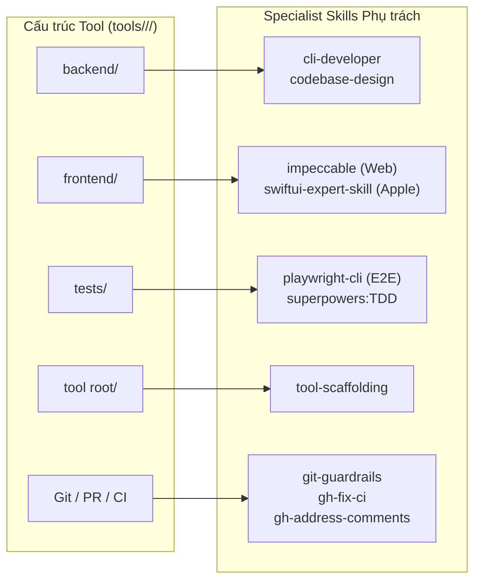

# Skills catalog for Development Space

This directory contains the local specialist skills available to agents operating within `development-space`.
Skills are strictly mapped to the **architectural folders of our tools** ([Standard tool layout](../../docs/standard-tool-layout.md)).

---

## 1. Tool-folder to skill mapping (Ánh xạ thư mục ➔ Kỹ năng)

Agents only activate a specialist skill when working on the matching tool component:

### Detailed responsibility breakdown:

| Thư mục Tool | Kỹ năng chuyên trách | Trách nhiệm chính |
| :--- | :--- | :--- |
| **`backend/`** | `cli-developer` `codebase-design` | Thiết kế cờ lệnh CLI, exit codes, non-interactive mode. Đảm bảo module sâu, giấu logic phức tạp. |
| **`frontend/`** | `impeccable` `swiftui-expert-skill` | **Web UI**: Information architecture, typography, responsiveness, UI polish. **Native Apple UI**: SwiftUI state `@Observable`, platform views, Liquid Glass. |
| **`tests/`** | `superpowers:TDD` `playwright-cli` | **Unit/Integration**: Viết test trước bằng TDD. **Browser E2E**: Tự động hóa kiểm thử trình duyệt cho web tools. |
| **`tool root/`** | `tool-scaffolding` | Khởi tạo repo độc lập, tạo `pyproject.toml`, dập khuôn chuẩn thư mục. |
| **`Git & CI`** | `git-guardrails` `gh-fix-ci` `gh-address-comments` | Chặn lệnh phá hủy git, đọc/sửa lỗi CI GitHub Actions, trả lời PR comments tự động. |
| **Toàn cục** | `xerj` & `xerj-hub` | Tìm kiếm mã nguồn và định nghĩa AST siêu tốc, không đốt token. |

---

## 2. Quan hệ với Superpowers

Phương pháp luận (Process & Discipline) luôn do plugin **Superpowers** quản lý toàn cục:
- Lập kế hoạch: `superpowers:writing-plans`
- Viết test trước: `superpowers:test-driven-development`
- Sửa lỗi hệ thống: `superpowers:systematic-debugging`
- Nghiệm thu: `superpowers:verification-before-completion`

Các kỹ năng tại thư mục này chỉ cung cấp **chuyên môn kỹ thuật sâu (domain depth)** cho từng thư mục cụ thể của tool mà Superpowers không can thiệp.

---

## 3. Metadata chuẩn máy đọc

Toàn bộ ràng buộc và điều kiện kích hoạt được ghi nhận tại file máy đọc [`index.yaml`](index.yaml).
