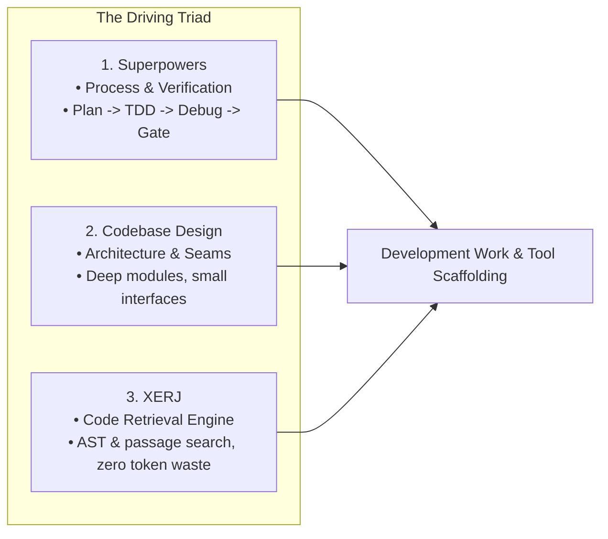
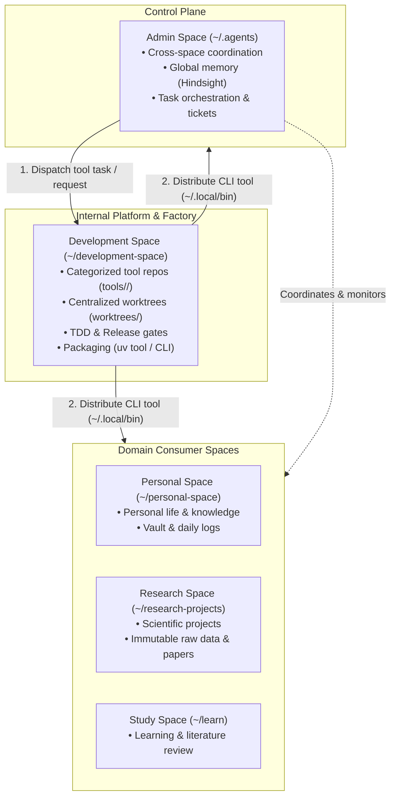

# Development Space architecture

Status: Working edition, 2026-10-24.
Repository: `https://github.com/taixuann/development-space.git`

## Responsibility

Development Space is the central software workshop and internal tool platform for Tai's agent ecosystem.
It owns:
1. Canonical repositories and development lifecycle of all shared tools categorized by consumer space (`tools/<space>/<tool-name>/`).
2. Centralized ephemeral task worktrees (`worktrees/<space>/<tool-name>_<task>/`).
3. Engineering discipline, verification, and test-driven development (`RELEASE_GATE.md`).
4. Tool packaging and distribution via isolated CLI binaries (`uv tool`) to all consumer spaces.

Development Space owns **no personal files, no private notes, and no raw scientific experimental data**.

---

## The driving triad (Bộ khung dẫn dắt)

All software engineering work in Development Space is driven by three core pillars:



1. **Superpowers**: The methodology engine. Every change follows strict planning, test-driven development (TDD), systematic debugging, and verification-before-completion.
2. **Codebase Design (`codebase-design`)**: The structural engine. Enforces deep modules where substantial capability hides behind minimal public interfaces.
3. **XERJ (`xerj`)**: The code retrieval engine. Provides local AST, BM25, and passage-level search across all tool codebases via CLI and MCP without burning context tokens on recursive file reads.

---

## Space ecosystem topology (Phân bổ các Space Base)

The system is organized into decoupled, specialized Spaces. Each Space keeps authority over its domain:



### Space roles and boundaries

| Space | Path | Role | Data ownership |
| :--- | :--- | :--- | :--- |
| **Admin** | `~/.agents` | Control Plane & Orchestrator | Hindsight memory bank `admin`, Notion sync, global automation jobs, agent identities. |
| **Development** | `~/development-space` | Internal Developer Platform & Workshop | Tool source code (`tools/<space>/`), worktrees (`worktrees/`), packaging configs, engineering docs. |
| **Personal** | `~/personal-space` | Personal Life & Second Brain | Private projects, notes, finances, personal automation. |
| **Research** | `~/research-projects` | Scientific Research Lab | Raw scientific instrument data (strictly immutable), analysis notebooks, paper manuscripts. |
| **Study** | `~/learn` | Study & Knowledge Synthesis | Literature notes, course materials, reading digests. |

---

## Tool categorization and repository boundaries

Tools are organized by their primary consumer domain under `tools/<space>/<tool-name>/`:

```text
tools/
├── admin/               # Tools serving Admin Space (Control plane, orchestration, model routing)
│   ├── opencode-free-router/   (Independent Git repo)
│   └── hindsight/              (Independent Git repo)
│
├── research/            # Tools serving Research Space (Data extraction, raw viewer, analytics)
│   └── raw-viewer-cli/         (Independent Git repo)
│
├── personal/            # Tools serving Personal Space (Vault sync, personal workflows)
│   └── vault-sync/             (Independent Git repo)
│
└── shared/              # Core libraries and utilities shared across multiple spaces
    └── secret-vault/           (Independent Git repo)
```

### Invariants:
1. **Independent Git repository**: Every tool contains its own `.git` directory and standalone version history.
2. **Parent isolation**: Development Space root Git completely ignores `tools/` and `worktrees/` via `.gitignore`.
3. **Standard layout**: Tools implement [Standard tool layout](docs/standard-tool-layout.md):
   - Mandatory: `backend/`, `tests/`, `README.md`, `AGENTS.md`, `pyproject.toml`.
   - Optional: `frontend/`, `database/`, `api/`, `automation/`.
4. **Isolated execution**: Changes are developed only within `worktrees/<space>/<tool-name>_<task>/`.

---

## Tool-folder to skill mapping (Ánh xạ thư mục ➔ Kỹ năng)

Skills in [.agents/skills/](.agents/skills/) are mapped directly to matching tool folders ([index.yaml](.agents/skills/index.yaml)):

| Tool component | Specialist skill | Primary responsibility |
| :--- | :--- | :--- |
| **`backend/`** | `cli-developer`<br/>`codebase-design` | Implement clean CLI flags, exit codes, non-interactive mode. Enforce deep modules. |
| **`frontend/` (Web)** | `impeccable` | Information architecture, typography, responsiveness, and UI craft. |
| **`frontend/` (Native)** | `swiftui-expert-skill` | SwiftUI architecture, `@Observable` state flow, Liquid Glass, platform views. |
| **`tests/`** | `superpowers:TDD`<br/>`playwright-cli` | TDD for unit/integration logic; Playwright for headless web browser automation. |
| **`tool root/`** | `tool-scaffolding` | Initialize compliant layout, pyproject.toml, and independent Git repo. |
| **`PR & CI`** | `git-guardrails`<br/>`gh-fix-ci`<br/>`gh-address-comments` | Prevent destructive git operations, inspect Actions logs, resolve PR review threads. |
| **Global** | `xerj` & `xerj-hub` | Fast local AST code search and external reference library lookup. |

---

## Tool distribution model (`uv tool` / CLI)

All shared tools follow the **Centralized Source + Isolated CLI Distribution** paradigm:

1. **Manifest configuration**: Each tool declares its console script in `pyproject.toml`:
   ```toml
   [project.scripts]
   <tool-command> = "backend.cli:main"
   ```
2. **Global installation**:
   ```bash
   uv tool install /Users/tai/development-space/tools/<space>/<tool-name> --force
   ```
3. **Execution across spaces**:
   `uv tool` places an isolated executable link at `~/.local/bin/<tool-command>`. Any Space (`Admin`, `Personal`, `Research`, `Study`) calls `<tool-command>` directly from `$PATH` with zero virtual environment friction and zero source code duplication.

---

## Directory layout

```text
/Users/tai/development-space/
├── USER.md                  # Collaboration rules with Tai
├── SOUL.md                  # Engineering workshop identity & principles
├── ARCHITECTURE.md          # Ecosystem topology, driving triad, and tool contracts
├── AGENTS.md                # Agent constraints, bounded execution, and XERJ rules
├── README.md                # Human runbook for the workshop
├── RELEASE_GATE.md          # Verification criteria before tool release
├── tools/                   # Independent tool repositories grouped by target space (ignored by git)
│   ├── admin/
│   ├── research/
│   ├── personal/
│   └── shared/
├── worktrees/               # Ephemeral task worktrees for isolated changes (ignored by git)
├── docs/                    # Architectural contracts and guides
│   ├── small-tool-contract.md
│   ├── standard-tool-layout.md
│   ├── tool-lifecycle.md
│   └── domain.md
├── .agents/skills/          # Local specialist skills catalog
│   ├── README.md            # Human runbook & Mermaid folder-skill mapping
│   ├── AGENTS.md            # Agent skill routing and precedence rules
│   ├── index.yaml           # Machine-readable skill registry
│   └── <skill-name>/        # Specialist skills
└── automation/              # Workshop-owned build & maintenance jobs
```
