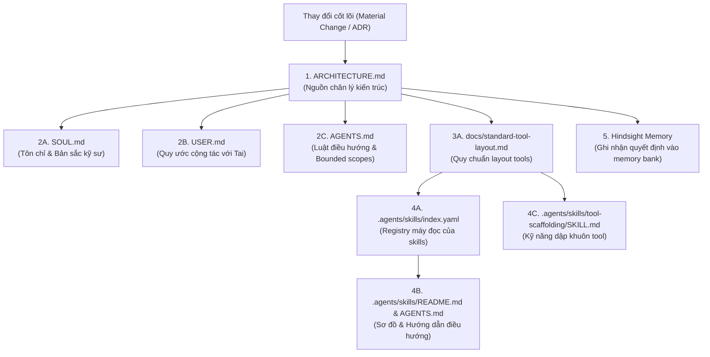

# Documentation maintenance and synchronization lifecycle

This guide defines how to propagate and synchronize material architectural changes across all documents in `development-space` without causing documentation drift or stale instructions.

---

## 1. Documentation dependency graph (Sơ đồ phụ thuộc)

Whenever a significant change occurs (new tool layer, skill restructuring, remote rename, distribution change), updates must cascade down the dependency hierarchy:



---

## 2. Trigger conditions (Khi nào cần chạy Doc Sync?)

Trigger a documentation synchronization run when any of the following occurs:
1. **Tool taxonomy change**: Reorganizing `tools/<space>/` categories or folder requirements (`backend/`, `frontend/`, `tests/`).
2. **Skill modification**: Adding, removing, or re-mapping specialist skills in `.agents/skills/`.
3. **Repository & remote changes**: Renaming GitHub repo, remote URL, or modifying root `.gitignore`.
4. **Distribution / packaging update**: Changing `uv tool` installation commands or CLI script conventions.
5. **Agent workflow evolution**: Adjusting Superpowers integration, TDD rules, or verification gates.

---

## 3. Four-step synchronization procedure

When Tai requests a documentation update or when an architectural decision is accepted:

### Step 1: Update the Single Source of Truth
- Edit `ARCHITECTURE.md` (or write a new ADR in `docs/adr/000X-<topic>.md`).
- Ensure the structural diagram, invariants, and directory tree are accurate.

### Step 2: Cascade updates to identity and interaction files
- In `SOUL.md`: Align the workshop's values, mission, and layer locality rules.
- In `USER.md`: Align collaboration rules, engineering standards, and boundaries.
- In `AGENTS.md`: Update bounded execution rules, specialist skill lists, and safety constraints.

### Step 3: Cascade updates to tool layout and skill catalog
- In `docs/standard-tool-layout.md` and `docs/tool-lifecycle.md`: Update folder definitions.
- In `.agents/skills/index.yaml`: Update machine-readable skill entries, conditions, and roles.
- In `.agents/skills/README.md` and `AGENTS.md`: Update the folder-to-skill mapping and routing rules.
- In `.agents/skills/tool-scaffolding/SKILL.md`: Update template generation to match the new layout.

### Step 4: Record to persistent memory & run integrity check
1. Capture the change in Hindsight memory using `hindsight_capture_initiative` so future sessions across all spaces remember the decision.
2. Run the documentation integrity checker:
   ```bash
   python3 automation/check_docs.py
   ```
3. Present the diff summary and verification output to Tai.
