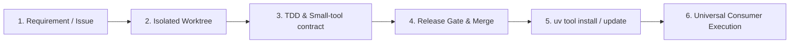

# Tool lifecycle and distribution

This document details the lifecycle of a tool within `development-space`, from design and implementation to global distribution via `uv tool`.

## Lifecycle stages



### 1. Requirements and issue
- Tasks come from an Admin request (`admin/<tool-name>_<request-id>`) or an internal development need.
- Public CLI interface, flags, inputs, and outputs must be specified upfront.

### 2. Isolated worktree
- Never develop directly on the canonical branch while other consumers or automations might read it.
- Spawn a dedicated worktree:
  ```bash
  git worktree add worktrees/admin/<tool-name>_<request-id> -b admin/<tool-name>_<request-id>
  ```

### 3. TDD & Small-tool contract
- Write tests first for happy path, invalid inputs, and main failure modes.
- Implement the minimum code that passes the tests ([Ponytail / YAGNI](../SOUL.md)).
- Fulfill all requirements in [Small-tool contract](small-tool-contract.md).

### 4. Release gate & merge
- Run tests in an isolated fixture environment.
- Review diff and verification evidence against [RELEASE_GATE.md](../RELEASE_GATE.md).
- Merge into the tool's `main` branch. Remove the task worktree:
  ```bash
  git worktree remove worktrees/admin/<tool-name>_<request-id>
  ```

### 5. Packaging and distribution (uv tool)
- The tool repository contains a valid `pyproject.toml` with console scripts:
  ```toml
  [project.scripts]
  my-tool = "my_tool.cli:main"
  ```
- Install or refresh the CLI executable in the user environment:
  ```bash
  uv tool install /Users/tai/development-space/tools/<tool-name> --force
  ```
- The binary is placed at `~/.local/bin/my-tool`.

### 6. Universal consumer execution
- Any Space (`Admin`, `Personal`, `Research`, `Study`) or scheduled automation can call `my-tool` directly without touching virtualenvs or repository source trees:
  ```bash
  my-tool --option value --json
  ```
